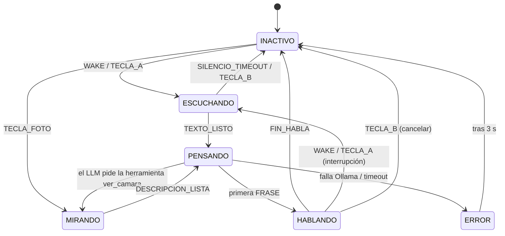

# Arquitectura del software

> **Estado:** propuesta inicial (semana 1). El Líder la confirma o ajusta en la semana 1. Cada cambio importante se registra como ADR en [`decisiones/`](decisiones/README.md).

## 1. Vista general

```
                         ┌──────────────────────── Raspberry Pi 5 ────────────────────────┐
                         │                                                                │
 Micrófono USB ─────────►│  Hilo AUDIO ──► wake word / VAD ──┐                            │
                         │                                   │                            │
 Botones (Pico, USB) ───►│  Hilo PRINCIPAL (Pygame)          ▼                            │
   = teclado             │   · dibuja la cara        ┌──────────────┐                     │
                         │   · lee teclas ──────────►│ Cola EVENTOS │                     │
                         │   ▲                       └──────┬───────┘                     │
                         │   │ estado_cambiado              ▼                             │
 Pantalla 5" ◄───────────│───┘                   Hilo AGENTE (máquina de estados)        │
                         │                          │       │         │                    │
 Cámara ────────────────►│◄── herramienta ver ──────┘       │         │                    │
                         │                                  ▼         ▼                    │
                         │                      Ollama (local)    Hilo VOZ ──► Piper ──────│──► Parlante USB
                         │                      gemma3 / visión   (cola de frases)         │
                         └────────────────────────────────────────────────────────────────┘
```

**Un solo programa Python** (`python -m bmo`) con 4 hilos. Ollama corre aparte como servicio del sistema.

| Hilo | Qué hace | Por qué separado |
|---|---|---|
| **Principal (UI)** | Ventana Pygame a pantalla completa: dibuja la cara, lee el teclado (botones) y publica eventos | Pygame exige correr en el hilo principal. Las teclas de la Pico llegan a esta ventana |
| **Audio** | Captura el micrófono sin parar en un búfer circular. Ejecuta openWakeWord y, cuando se le pide, graba hasta el silencio (VAD) | No se puede perder audio mientras el agente piensa |
| **Agente** | Máquina de estados: consume eventos, llama a Whisper, Ollama y herramientas | Las llamadas lentas no congelan la cara |
| **Voz** | Recibe frases en una cola, las sintetiza con Piper y las reproduce. Se puede vaciar al instante (interrupción) | BMO habla mientras el LLM sigue generando |

Los hilos se comunican **solo con colas** (`queue.Queue`). Ningún hilo modifica variables de otro.

## 2. Máquina de estados



| Estado | Cara | Micrófono | Qué hace el agente |
|---|---|---|---|
| `INACTIVO` | Parpadea, sonríe | Solo wake word | Espera eventos |
| `ESCUCHANDO` | Ojos abiertos, ondas | Graba hasta el silencio | Transcribe al terminar |
| `PENSANDO` | Ojos que giran / puntos | Solo wake word (interrupción) | Llama al LLM y a las herramientas |
| `MIRANDO` | Ojos enfocados, flash | Solo wake word | Toma la foto y la describe |
| `HABLANDO` | Boca animada | **Silenciado para la wake word** (evita que BMO se active con su propia voz) | Envía frases a la cola de voz |
| `ERROR` | Cara confundida | Solo wake word | Registra el error y vuelve a `INACTIVO` |

Lista completa de eventos: ver [contratos.md §3](contratos.md#3-eventos).

## 3. Flujo de una pregunta

1. **Activación:** el hilo Audio detecta "Hey BMO" → evento `WAKE` → estado `ESCUCHANDO`.
2. **Grabación:** se graba hasta 0.8 s de silencio (VAD), con un máximo de 15 s.
3. **Transcripción:** `escuchar()` → Whisper → texto → evento `TEXTO_LISTO`.
4. **Decisión:** el Agente llama a `pensar()`. El LLM responde en JSON:
   - `{"herramienta": "ver_camara", "argumentos": {"pregunta": "..."}}` → se ejecuta la herramienta, se agrega el resultado al historial y se vuelve a llamar al LLM (máximo **2 herramientas por pregunta**).
   - `{"respuesta": "..."}` → se pasa a la respuesta hablada.
5. **Respuesta:** la respuesta llega por partes (*streaming*). Cada vez que se completa una frase (`.`, `!`, `?`), se envía a la cola de Voz. BMO empieza a hablar con la primera frase.
6. **Fin:** la cola de Voz se vacía → `FIN_HABLA` → `INACTIVO`.

**Presupuesto de latencia** (objetivo: < 4 s desde que el usuario calla hasta que BMO empieza a hablar):

| Etapa | Objetivo |
|---|---|
| Detección del fin de la frase (VAD) | 0.8 s |
| Whisper (`base`, frase de 5 s) | ≤ 1.2 s |
| LLM hasta la primera frase completa | ≤ 1.5 s |
| Piper, primera frase | ≤ 0.5 s |

Cada etapa registra su duración en el log (ver §6) para comparar con esta tabla.

## 4. Herramientas

| Herramienta | Argumentos | Devuelve | Requiere internet |
|---|---|---|---|
| `ver_camara` | `pregunta: str` | Descripción de la imagen | No |
| `consultar_notas` | `consulta: str` | Fragmentos relevantes de `ia/notas_rag/` | No |
| `hora_fecha` | — | Hora y fecha actuales | No |
| `buscar_web` | `consulta: str` | 3 resultados resumidos (DuckDuckGo) | **Sí** (si no hay conexión, devuelve "sin conexión" y no lanza error) |

Cada herramienta es un archivo en `software/bmo/herramientas/` con una función y una descripción. El LLM recibe la lista de herramientas en el prompt de sistema. Para agregar una herramienta no hay que tocar el agente: se registra sola.

## 5. Memoria y configuración

- **Historial:** los últimos **6 turnos** de conversación, solo en RAM. Se borra tras 5 min en `INACTIVO`.
- **Configuración:** `software/config.yaml` (copiado de `config.example.yaml`). Ningún valor (modelos, umbrales, rutas, volumen) va escrito en el código. Claves: ver [contratos.md §4](contratos.md#4-configuración).
- **Modelos cargados:** Ollama con `keep_alive: -1` para que el LLM no se descargue de la RAM.

## 6. Logs y errores

- Se registra con el módulo `logging` hacia la salida estándar; en la Pi la captura `journald` (`journalctl -u bmo -f`).
- Cada pregunta tiene un id. Por cada etapa se registra: `id`, `etapa`, `duracion_ms`.
- **Ningún error detiene el programa:**
  - Una excepción en el agente → estado `ERROR` → `INACTIVO`.
  - Si el programa se cae, `systemd` lo reinicia (ver [`despliegue/`](../despliegue/README.md)).

## 7. Pruebas

- **Sin hardware:** cada módulo de IA tiene una versión simulada (`software/tests/simulados/`) que cumple el mismo contrato. Así el bucle completo se prueba en un PC con texto.
- **Unitarias:** transiciones de la máquina de estados, división de frases y lectura del JSON del LLM.
- **En la Pi:** el script `software/scripts/prueba_latencia.py` mide las etapas de §3 con 20 preguntas fijas (`ia/prompts/preguntas_prueba.md`).

## 8. Decisiones pendientes

- [ ] UI con Pygame (propuesta) o Chromium en modo kiosko → ADR 0002
- [ ] Moondream o Gemma 3 para visión → ADR según el benchmark de la semana 2
- [ ] `gemma3:1b` o `gemma3:4b` → ADR según el benchmark de la semana 2
- [ ] `faster-whisper` o `whisper.cpp` → ADR según el benchmark de la semana 2
